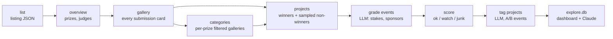

# hackathon-index

A local, queryable database of past hackathons: their prizes, judges and submissions, with full pages for every winner and a balanced sample of non-winners. It's built to answer one question with data instead of folklore: **what actually wins?**

Devpost is the first source. The schema is source-agnostic, so other platforms (Lablab, DoraHacks) or offline events can be added as new `sources/<platform>` packages.

```
  Events    7,565 listed · 4,379 prize pages · 1,429 galleries · 673 with categories
  Projects  152,320 projects · 18,646 winners · 30,841 full pages
  Pages     51,304 saved · 0 failed
  Scoring   970 ok · 275 watch · 184 junk
```
<sub>Coverage as of October 2026: events that ended from 2022 onward, galleries for events with at least $1k in cash prizes.</sub>

## Highlights

- **Polite, resumable crawler.** Every page is cached the moment it arrives, so nothing is fetched twice and a crash or Ctrl-C resumes where it stopped. Pacing adapts to the server: it backs off on 429/403/5xx, honours `Retry-After`, and halts rather than hammering.
- **Collect first, parse later.** Raw pages are kept gzipped. Improving a parser means re-parsing the saved pages on every CPU core, not crawling again.
- **Non-winners sampled on purpose.** "Winners use X" means nothing unless losers use X less. Each event gets a capped, deterministic sample: the most-liked near-misses, then round-robin across prize categories, then a seeded random fill.
- **Nothing is ever destroyed.** Every cleaning step writes a new versioned run to its own table and snapshots the database first. Any earlier state is one `restore` away.
- **One entry point.** `./run.sh` opens an interactive menu that shows the equivalent command for every choice. The same flags work in scripts and cron.

## Quick start

Requires Python 3.10+.

```bash
git clone https://github.com/m-azzam-azis/hackathon-index && cd hackathon-index
./run.sh            # sets up .venv on first run, then opens the menu
```

```
? What do you want to do?
 » Status: what's collected so far
   Update: new events and newly announced winners
   Go further back: add an earlier year
   Sample non-winners: full pages for a balanced sample
   Re-parse saved pages (after a parser update, no network)
   Grade events with an LLM: stakes, sponsors, competition
   Score events: flag junk and swag-only events
   Tag projects with an LLM: domain, AI use, originality, depth
   Dashboard: browse, filter and search in your browser
   Connect Claude: let Claude Code or Desktop query the data
   Snapshots: list, save, or restore a copy of the database
   Quit
```

Each choice prints its command line (for example `./run.sh crawl all --since 2022-01-01`) and asks before running it. On macOS the laptop is kept awake while crawling.

### Updating

`./run.sh` pulls the latest code each time. If you've committed locally, the pull can't fast-forward and the old code runs (it warns you). To go back to the published version, keeping your data, `.env` and `anchors.txt` (none of them are tracked):

```bash
git fetch && git reset --hard origin/main
```

## Pipeline



| Stage | Fetches | For which events |
|---|---|---|
| `list` | Devpost's listing API, 40 events per request | every ended event that closed on or after `--since` |
| `overview` | the event page: prize blocks and judges | in window, not invite-only, with any cash prize |
| `gallery` | every gallery page (title, tagline, likes, team, winner badge) | winners announced and estimated cash ≥ `--min-cash` |
| `categories` | galleries filtered by each prize, up to `--category-pages` pages | events with ≥ `--min-submissions` entries; runs with the non-winner pass |
| `projects` | full project pages: writeup, built-with, links, videos, team | all winners, plus `--loser-rate` of non-winners clamped to `--min-losers`..`--max-losers` |

Filters are deliberately loose so small but real events aren't dropped. Separating signal from noise is the job of the scoring step, which works on the stored data.

## Design notes

**Pacing.** By default, 3 workers each make a request every 0.5 s plus jitter. Every retryable failure doubles the shared interval (up to 30 s), and 50 successes in a row ease it back. Retries wait 1, 2, 5, then 10 minutes. If 3 URLs in a row fail even after all retries, the run stops cleanly. Workers only fetch and parse; every database write happens on the main thread, and a lock file stops two runs from sharing a data folder.

**Monthly updates.** Listing pages are re-fetched only while they still hold events that ended in the last 60 days (`--refresh-days`). So a monthly `Update` picks up new events and newly announced winners without walking old history again.

**Non-winner sampling.** The sample is keyed on project URLs, not database ids. The same event always yields the same picks, new events never change old ones, and raising the cap only adds projects. Huge events stay bounded: a 600-entry event gets 40 non-winners, not 90.

**Cash estimate.** A prize block labelled "$X in cash" counts as cash with high confidence. Otherwise amounts are pulled from the prize text, skipping ones followed by "credits", "gift card", "worth of" and the like, and the estimate is marked low confidence. It only decides which galleries to crawl; the LLM event labels below give the real split.

**Junk scoring.** Weighted flags per event, summed into `ok` (≤ 1), `watch` (2–3) or `junk` (≥ 4). Nothing is excluded; analysis filters on the tier.

| Flag | Weight | Meaning |
|---|---|---|
| `no_cash` | +4 | only swag, gift cards or credits found in the prizes |
| `tiny_field` / `small_field` | +3 / +1 | under 10 / 10–19 submissions |
| `low_cash` | +2 | some cash, but under $1k |
| `few_registrants` | +2 | under 30 registrants |
| `prize_per_entry_absurd` | +2 | over $2,500 per submission with under 20 entries |
| `no_judges`, `one_off_organizer`, `weak_winner_writeups`, `winners_without_code` | +1 each | weaker signals |
| `managed_by_devpost` / `repeat_organizer` | −2 / −1 | trust signals (`repeat_organizer` only for events without an LLM grade) |

**LLM event grades.** A legit event isn't automatically worth learning from: a well-run campus weekend whose prizes are stock partner swag teaches little about winning a big online challenge. So one LLM call per event reads the event page the way a person would: every prize block, the organizer, judges and field size. It returns what the prizes are really worth (cash, gift cards, credits, products and token prizes separately, so real hardware isn't mistaken for swag and a padded headline is caught) and three 0–10 scores. A fixed weighting turns them into a 0–100 quality score and an A–D grade:

| Score | Weight | Question |
|---|---|---|
| `stakes` | 40% | how much is winning worth, and is it a few real prizes or many token ones? |
| `sponsor_caliber` | 30% | how significant are the companies funding and judging the main prizes? |
| `competition` | 30% | how hard was it to win: field size, online vs local, professional vs student? |

Two rules encode the researcher's own judgement: a company-run online challenge with at least $5k in cash is at least a B however small, and a student event is at most a B however big. Stock partner prizes cost 5 points and an unverifiable event is capped at 20. Winning projects are left out on purpose: they're what the analysis studies, so they shouldn't also decide which events count. Scoring then uses the grades in place of the rough cash and organizer rules. The client works with any OpenAI-compatible API, and the key goes in a git-ignored `.env` file (`OPENROUTER_API_KEY=...`).

Test before a full run: `label-events --sample 30` grades a spread of events with two cheap models and writes a side-by-side review file without touching the database. Hackathons listed in `anchors.txt` as great, ok or meh (see `anchors.example.txt`) are always included, and the review counts how many each model agrees with. A full run over about 1,400 events costs one to two dollars with a flash-class model. It stops at `--max-cost` and resumes if interrupted.

**Project tags.** Every full project page from an event graded A or B (`--grades ABC` adds C), winners and sampled non-winners alike, is tagged by an LLM. Projects go in shuffled batches of up to eight from the same event, so the model scores them side by side: scored alone, nearly every project lands on a 5–7, while a comparison spreads the scores and adjusts for how strong the event was. The model is never told who won, so both groups are tagged the same way and win rates compare like with like. Each project gets:

| Field | Values |
|---|---|
| `domain` | health, education, fintech, climate, accessibility, devtools, productivity, social, gaming, security, commerce, civic, science, other |
| `ai_role` | none, llm_wrapper, rag, agent, multi_agent, custom_ml, computer_vision, voice |
| `form` | web_app, mobile_app, browser_extension, hardware, bot, game, ar_vr, api_library, data_analysis, other |
| `sponsor_tech` | central, passing, none |
| `originality`, `technical_depth`, `polish` | 0–10 each, relative to the rest of the batch |
| `batch_rank`, `batch_size` | 1 = strongest of the projects scored together |
| `specific_user`, `real_use` | names a specific user; shows real users, a pilot or a deployment |
| `summary` | one plain sentence, for the dashboard and similarity search |

`tag-projects --sample 40` tests two models on batches that mix winners and non-winners, and reports how often a winner outscores a non-winner from the same batch (50% is a coin flip), how spread out the scores are, and the projected cost of a full run. The full run is resumable and stops at `--max-cost`.

**Dashboard.** `./run.sh dashboard` rebuilds `data/explore.db` from `index.db` (about 15 seconds) and opens it in [Datasette](https://datasette.io) on localhost. `explore.db` is a flat, throwaway copy of the analysis set: `projects` (tags, scores, prizes won, repo and video links, team profiles), `events` (grade, prize split), `builders` (Devpost profiles with their wins), `traits` (within-event win gaps for every tag, flag and common technology) and a full-text index. Facets slice projects by grade, year, domain, AI role, form and sponsor-tech use, and ready-made queries cover what wins, what loses, technologies by win gap, winners built with a given technology, top builders and the best events to learn from.

Win rates are always measured **within an event**: for each event with both winners and non-winners, the winners' share with a trait minus the non-winners' share, averaged with each event weighted by its smaller group. Non-winners are a capped sample, so raw rates would mostly reflect the sampling.

**Ask Claude.** `./run.sh mcp-config` prints the line that registers a local [MCP](https://modelcontextprotocol.io) server with Claude Code, and the JSON for Claude Desktop. Claude then gets four read-only tools over the same data (`describe`, `sql`, `what_wins`, `search_projects`) and can answer questions like "what do winners of AWS challenges have in common?" on a normal Claude subscription, with no API key. Both databases are opened read-only and long queries are cut off.

**Snapshots.** `score`, `label-events`, `tag-projects`, `--reparse` and `restore` each save a full copy of `index.db` to `data/snapshots/` first (about 270 MB each today). Delete old copies by hand when space matters.

## Commands

Everything the menu does is also a command. `./run.sh <command>` and `hackathon-index <command>` are equivalent; options alone (`./run.sh --loser-rate 0.15`) mean `crawl all`.

| Command | What it does |
|---|---|
| `menu` | the interactive menu (default for `./run.sh` in a terminal) |
| `status` | what's collected so far |
| `crawl {list,overview,gallery,categories,projects,all}` | run one stage, or all of them in order |
| `label-events [--sample N] [--model M]` | LLM grade per event; `--sample` writes a review file only |
| `score` | junk-event scoring; a new run each time, earlier runs kept |
| `dashboard [--port 8001]` | rebuild `explore.db` and open it in Datasette |
| `mcp` · `mcp-config` | MCP server for Claude (stdio) · print how to register it |
| `tag-projects [--sample N] [--model M] [--grades AB]` | LLM tags per project in A/B events; `--sample` writes a review file only |
| `snapshot [label]` · `snapshots` · `restore NAME` | save, list, and go back to copies of the database |

Useful `crawl` options:

| Option | Default | |
|---|---|---|
| `--since` | `2024-01-01` | keep events that closed on or after this date |
| `--min-cash` | `1000` | USD cash needed to crawl an event's gallery |
| `--loser-rate` / `--min-losers` / `--max-losers` | `0` / `0` / `40` | non-winner sample per event |
| `--top-liked` | `10` | how many of the sample are the most-liked |
| `--min-submissions` | `10` | skip categories and non-winners for smaller events |
| `--workers` / `--interval` | `3` / `0.5` | parallel requests, seconds between requests per worker |
| `--reparse` | | re-parse saved pages instead of fetching |
| `--limit` | | only the N most recent qualifying events (pilot runs) |

## Data model

Everything lands in `data/index.db` (SQLite). Open it with `sqlite3`, DB Browser for SQLite, or Datasette.

| Table | One row per |
|---|---|
| `hackathons` | event: dates, organizer, themes, registrants, submissions, cash estimate, judges count |
| `prizes` | prize block: title, value, "in cash" flag, winner count, description |
| `judges` | judge: name and title |
| `projects` | project: title, tagline, likes, built-with, links, `has_repo`, `video_urls`, `writeup` (JSON section → text) |
| `submissions` | project × event, with `is_winner` and gallery rank (projects are often entered in several events) |
| `submission_prizes` | prize a project won, e.g. "Best Use of Neo4j" |
| `submission_categories` | prize category a project entered |
| `people`, `project_members` | Devpost profiles, for builder track records |
| `pages` | every fetched URL: status, time, path of the gzipped body |
| `enrich_runs` | each cleaning run: step, rules version, parameters, snapshot taken before it |
| `event_labels` | each event's LLM grade in each run: prize values, four scores, quality, grade (`event_labels_latest` view) |
| `event_scores` | each event's junk score in each run (`event_scores_latest` view) |
| `project_tags` | each project's LLM tags in each run: domain, AI role, form, sponsor tech, three scores, summary (`project_tags_latest` view) |

## Project layout

```
hackathon_index/
  __main__.py          CLI
  menu.py              interactive menu
  db.py                schema and migrations
  fetcher.py           cached, adaptive, thread-safe HTTP fetcher
  progress.py          one-line live progress
  money.py             currency amounts in prize text
  llm.py               OpenAI-compatible client (OpenRouter by default), .env loading
  label_events.py      LLM grade per event
  score.py             junk-event scoring
  tag_projects.py      LLM tags per project
  explore.py           explore.db: flat analysis tables and within-event win gaps
  datasette.json       dashboard facets and ready-made queries
  mcp_server.py        read-only MCP tools for Claude
  snapshot.py          database copies and restore
  sources/devpost/
    crawl.py           the five crawl stages and non-winner sampling
    parse.py           pure parsers: HTML/JSON in, dicts out
tests/                 parsers, pipeline, fetcher, parallel crawl, labels, scoring, menu
run.sh                 entry point: pull, set up .venv, run
```

## Development

```bash
pip install -e '.[dev]'
pytest -q
```

The tests run offline: parsers against trimmed real pages, and the full pipeline against a fake Devpost served through `httpx.MockTransport`. They check that parallel and sequential crawls give identical results, that resume makes no requests, and that sampling is stable.

## Roadmap

- Win gaps split by event size, year and sponsor
- Local embeddings for "projects like this one" search
- Eligibility and rules text from the saved event pages
- More sources: Lablab, DoraHacks, offline events

## Responsible use

This is a personal research tool. It caches every page so nothing is requested twice, keeps request rates low, backs off as soon as the server pushes back, and identifies itself in its user agent. The collected data (`data/`) is not part of the repository. Check the terms of any site before crawling it.
